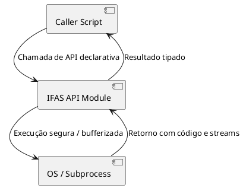

# RFC-XXXX — [Título da RFC / Nome da API ou Funcionalidade]

**Status:** [Draft | In Review | Accepted | Rejected | Superseded by RFC-YYYY]  
**ADR Vinculada:** [ADR-XXXX — Título da ADR correspondente]  
**Autores:** [Nome / Papel / Agente de IA]  
**Data de Criação:** AAAA-MM-DD  
**Data da Última Atualização:** AAAA-MM-DD  
**Milestone / Sprint Alvo:** [Ex: M3 - Arquitetura InstantFPC / M4 - MVP]  

---

## 1. Sumário Executivo
Resumo conciso (1 a 2 parágrafos) do que esta RFC propõe, a quem se destina e o impacto direto no ecossistema IFAS.

---

## 2. Problema e Motivação

### 2.1 Problema
- Qual é a deficiência, limitação ou necessidade técnica atual?
- O que acontece se não resolvermos isso agora?

### 2.2 Motivação
- Por que esta solução é importante para a plataforma e para os desenvolvedores?
- Como ela se alinha com a visão de *"Automate the Boring Stuff with Pascal"* e scripts nativos?

---

## 3. Objetivos e Limites de Escopo

### 3.1 Objetivos (Goals)
- [ ] O que **será** entregue e suportado de forma obrigatória.
- [ ] Capacidade mensurável 2.

### 3.2 Não-Objetivos (Non-Goals)
- O que está **deliberadamente fora de escopo** nesta RFC para evitar *scope creep* e complexidade acidental.

---

## 4. Especificação Técnica e Design Detalhado

### 4.1 Modelagem e Diagramas (DDD & PlantUML)
Diagramas de componentes, fluxos de dados ou modelagem de domínio:



### 4.2 Definições de Tipos e Contratos (Pascal / FreePascal)
Assinaturas de interfaces, records, classes e namespaces:

```pascal
unit IFAS.Core.Exemplo;

{$mode objfpc}{$H+}

interface

uses
  SysUtils, Classes;

type
  { Contrato público da funcionalidade }
  IIFASService = interface
    ['{GUID-GERADO}']
    function Execute(const ACommand: string): Boolean;
    function GetOutput: TStrings;
  end;

implementation

end.
```

### 4.3 Exemplos Práticos de Uso (Developer Experience)
Exemplo real de como um usuário ou script InstantFPC consumirá a API:

```pascal
program ExemploUso;

{$mode objfpc}{$H+}

uses
  IFAS.Core.Exemplo;

var
  Service: IIFASService;
begin
  Service := CreateService();
  if Service.Execute('meu-comando') then
    WriteLn(Service.GetOutput.Text);
end.
```

---

## 5. Portabilidade e Impacto em Recursos

### 5.1 Portabilidade Multiplataforma
- **Linux:** Suporte nativo (POSIX).
- **macOS:** Suporte Darwin / BSD.
- **Windows:** Compatibilidade de paths, separadores e processos.
- *Tratamento de diferenças de sistema operacional sem expor complexidade desnecessária ao usuário.*

### 5.2 Impacto e Desempenho
- **Tempo de compilação InstantFPC:** Impacto no tempo de startup e compilação just-in-time.
- **Uso de Memória e Recursos:** Liberação determinística de memória (*sem memory leaks*).
- **Dependências Externas:** Exige bibliotecas do sistema ou compila puramente com FPC stdlib?

---

## 6. Segurança, Invariantes e Tratamento de Erros

- **Invariantes do Módulo:** Quais condições são sempre verdadeiras antes, durante e após a execução.
- **Tratamento de Falhas (*Fail-Fast*):** Como erros de I/O, permissão ou timeouts são capturados e reportados.
- **Segurança Operacional (*Automação Conservadora*):** Proteção contra injeção de comandos, mutações acidentais e privilégios excessivos.

---

## 7. Compatibilidade e Migração (Breaking Changes)

- Esta alteração introduz quebra de compatibilidade com versões/APIs anteriores?
- Se sim, qual é a estratégia de depreciação e o caminho de migração recomendado?

---

## 8. Alternativas Consideradas e Descartadas

| Alternativa | Prós | Contras | Motivo do Descarte |
|---|---|---|---|
| **Abordagem A** | Simplicidade inicial | Alto acoplamento | Inviável para testes |
| **Abordagem B** | Reuso de lib externa | Dependência C pesada | Fere portabilidade pura FPC |

---

## 9. Plano de Implementação e Critérios de Aceite (DoD)

### 9.1 Etapas de Implementação
1. [ ] **Fase 1:** Prototipagem da interface e validação de viabilidade.
2. [ ] **Fase 2:** Implementação do core com testes unitários (FPCUnit).
3. [ ] **Fase 3:** Exemplos práticos em `implementations/instantfpc/examples/`.
4. [ ] **Fase 4:** Documentação e publicação de capítulo/tutorial.

### 9.2 Critérios de Conclusão da RFC
- Cobertura de testes automatizados passando em ambiente limpo.
- Nenhum leak de memória detectado pelo `HeapTrc`.
- Documentação e lições registradas no Design Journal se houver anomalias.

---

## 10. Questões em Aberto (Unresolved Questions)

- [ ] *Questão 1 sob debate entre os arquitetos.*
- [ ] *Questão 2 aguardando benchmark ou prova de conceito.*

---

## 11. Rastreabilidade

- **Princípio Arquitetural:** [Ex: IFAS-P-001 — Tradutibilidade]
- **Princípios de Engenharia:** [Ex: IFAS-E-001 Idempotência, IFAS-E-003 Fail-Fast, IFAS-E-004 Responsabilidade Única]
- **ADR Base:** [`ifas/architecture/adr/ADR-XXXX.md`]
- **Issues GitHub:** [#Número]
